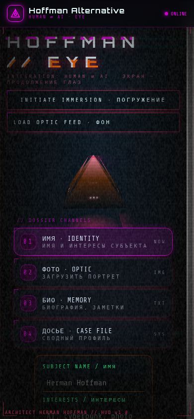

# HOFFMAN // EYE

A cyberpunk concept site on the theme of human and AI integration: the screen as an extension of your eyes.

**[▶ Live demo](https://hoffman-alternative.github.io/hoffman-eye/)**

## Features
- 3D immersion: three parallax depth layers with tilt from the mouse or gyroscope
- Pyramid "eye" navigation: each face is a section of the dossier
- Upload a photo and it's processed live in canvas (glitch, RGB shift, noise, torn bytes, scanlines)
- Palette follows the time of day, from cool morning blue to a red night when "the eye wakes"
- Dense live HUD, terminal fonts, CRT effects
- Portrait mobile layout with chat-style tabs
- One self-contained `index.html`, no build, no frameworks

## Case studies
- [Retro terminal portal with an AI assistant](case-studies/terminal-portal.md)

## Run
Open `index.html`, or serve it: `python3 -m http.server`.

---
Design & code: **Herman Hoffman** · [Hoffman Alternative](https://github.com/HOFFMAN-ALTERNATIVE)
