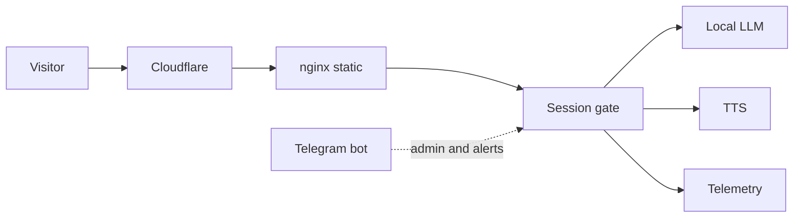

# Case study: retro terminal portal with an AI assistant

A production site built as an interactive retro-futuristic terminal (Pip-Boy / CRT aesthetic) with a built-in AI assistant, running entirely on one CPU-only VPS.

## Stack
- **Frontend:** static HTML/CSS/JS served by nginx (alpine) in Docker; React-style glitch boot screen; CRT effects (scanlines, flicker, power-off collapse)
- **Edge:** Cloudflare (TLS, caching, WAF, rate limits); origin hidden behind the proxy
- **Backend:** small Python services on localhost: session gate, text-to-speech, system telemetry, AI proxy
- **AI:** local LLM through Ollama, quantized 8B/14B models on CPU, no GPU
- **Ops:** systemd units and timers, rotated backups, flood watch, alerts to a Telegram bot

## Architecture

## Features
- Animated boot and login screen with a glitch effect and a pixel dissolve on success
- Two access levels: an owner console and a time-limited guest demo with a nixie-style countdown and a CRT shutdown at the end
- Live HUD with a weather widget, clock, CPU/RAM graphs and a process table
- AI chat with voice replies
- Fully responsive, from mobile portrait to desktop landscape

## Engineering notes
- Every backend listens on localhost only; nginx and Cloudflare are the single public entry
- Passwords stored as salted hashes, verified server-side; guest sessions are short-lived and limited
- Client-facing screens never reveal internal hosts or ports
- The LLM is tuned for CPU: 4-bit quantization, one thread per core, a small context and the model kept resident in memory
